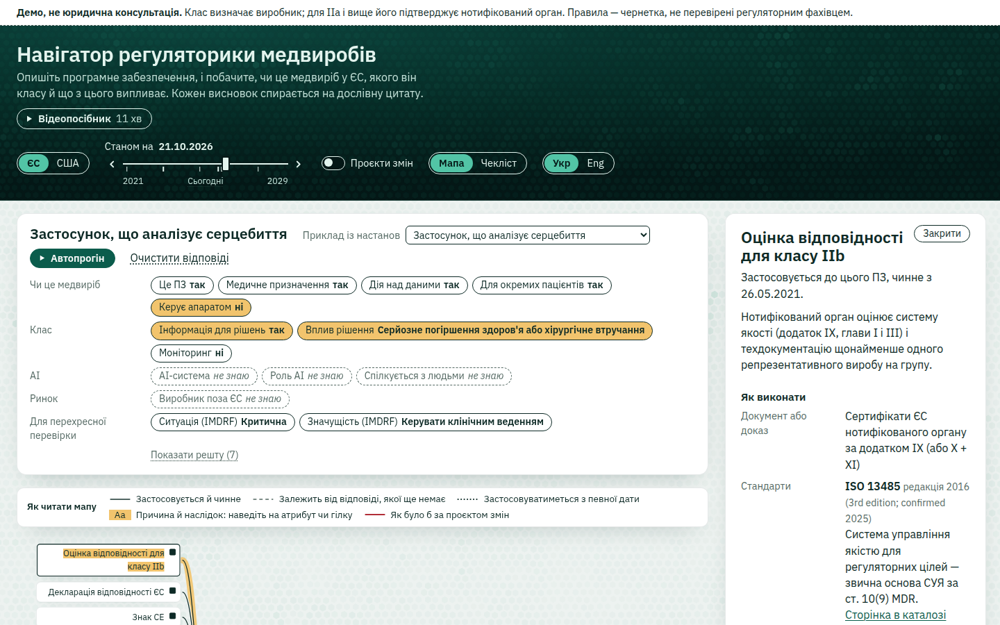
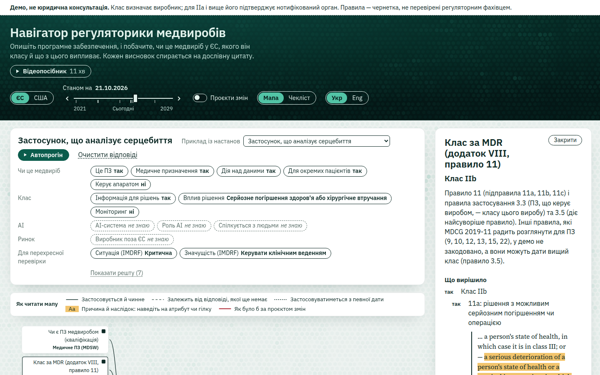
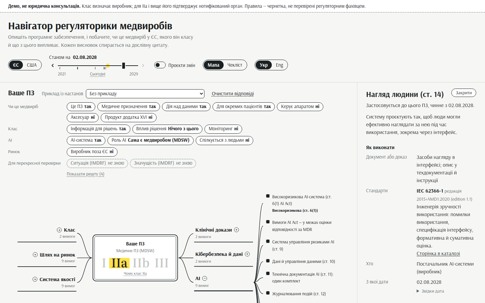
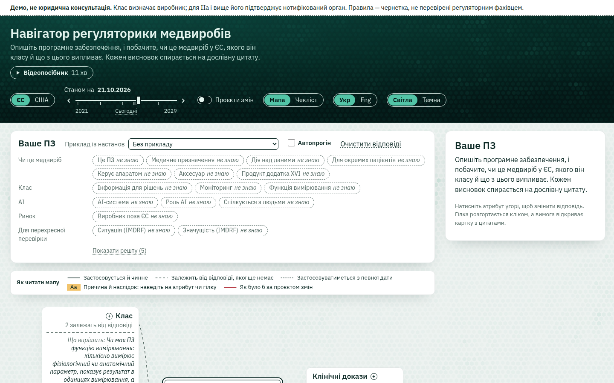
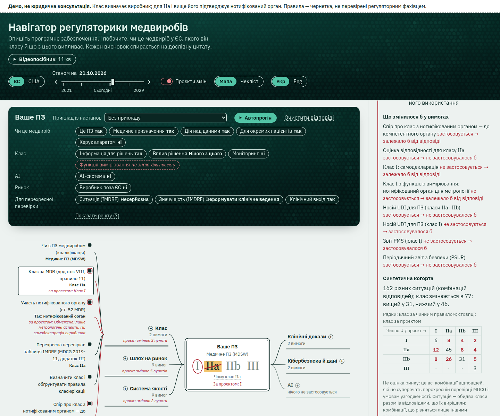
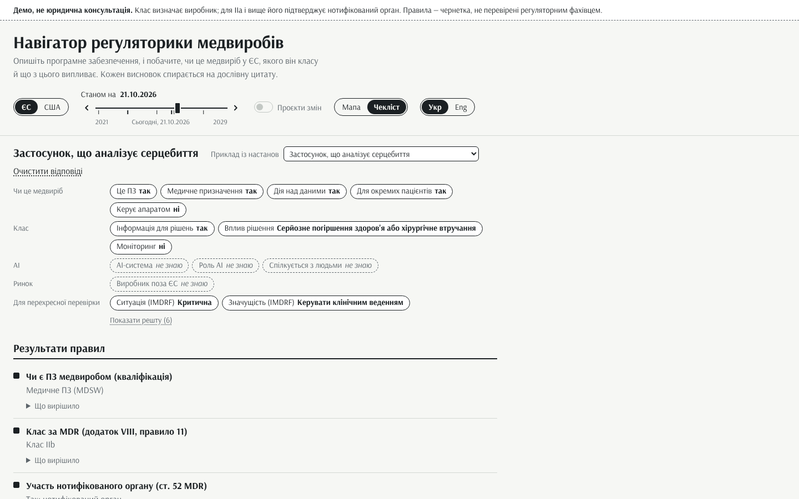
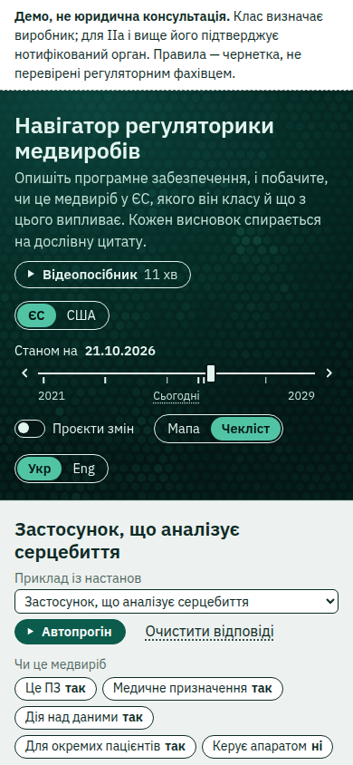
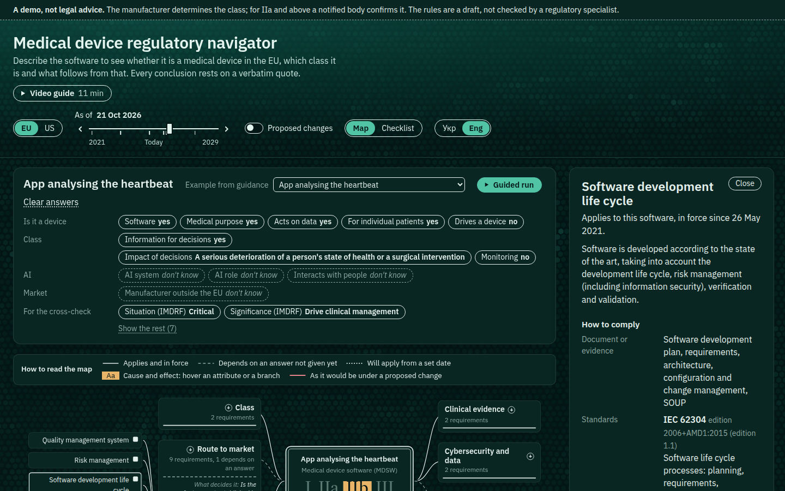

# MedReg Navigator

Демо для портфоліо: користувач описує медичне програмне забезпечення атрибутами й бачить, чи це медвиріб у ЄС, який у
нього клас за MDR, що з цього випливає за AI Act і які обов'язки, документи й стандарти потрібні. Кожна відповідь
простежується до дослівної цитати офіційного тексту, і браузер сам перевіряє цю цитату.

> **Демо, не юридична консультація.** Клас визначає виробник; для IIa і вище його підтверджує нотифікований орган.
> Правила — чернетка, не перевірені регуляторним фахівцем.

**Живе демо:** <https://ytsuhen.github.io/MedRegNav/> — статична сторінка, рушій працює в браузері, нічого нікуди не
надсилається. Публікує її workflow [`pages.yml`](.github/workflows/pages.yml), щойно в репозиторії ввімкнено GitHub Pages
(Settings → Pages → Source: GitHub Actions); до того збірку можна завантажити як артефакт запуску workflow.

**Відеопосібник** (10:46, озвучка англійською, субтитри українською, 10 розділів): кнопка «Відеопосібник» під
заголовком демо відкриває програвач зі списком розділів. Що відповідає демо, як читати мапу й картки і наскільки йому
довіряти — на тих самих екранах. Файл лежить поруч зі сторінкою
([`apps/web/public/video/`](apps/web/public/video/)), тож демо й далі не звертається до інших доменів.



## Що вміє

- **Чи це медвиріб.** Кваліфікація ПЗ за MDR, ст. 2(1) і 2(12), кроками MDCG 2019-11 rev.1: медичне ПЗ (MDSW), ПЗ у
  складі виробу чи аксесуар, продукт додатка XVI, не медвиріб.
- **Клас за MDR.** Додаток VIII, правило 11 разом із правилами застосування 3.3 (ПЗ, що керує виробом, — не нижче класу
  цього виробу) і 3.5 (діє найсуворіше правило); перехресна перевірка таблицею IMDRF з MDCG 2019-11 rev.1, додаток III.
- **Нотифікований орган і AI Act.** Чи потрібна оцінка нотифікованим органом (зокрема лише метрологічна для класу I з
  функцією вимірювання) і чи AI-система високоризикова за ст. 6(1) AI Act — з датою застосування вимог 2 серпня 2028 року.
- **Обов'язки.** 44 вимоги в шести гілках (клас, шлях на ринок, система якості, клінічні докази, кібербезпека й дані,
  AI), кожна з умовою застосування, датами чинності, «як виконати» (документ чи доказ, стандарт, хто, з якої дати) і
  дослівними цитатами.
- **«Не знаю» — теж відповідь.** Тризначна логіка: невідомий атрибут дає множину можливих результатів, а не вгадування;
  питання, що їх звузять, стоять просто на мапі, кожне один раз.
- **Станом на дату.** Повзунок із ключовими датами з даних: що вже чинне, що застосовуватиметься пізніше.
- **Проєкти змін.** Перемикач показує червоною ручкою, як змінився б результат, якби ухвалили пропозицію Єврокомісії
  COM(2025) 1023 (нове правило 11), з матрицею переходів класів на синтетичній когорті.
- **Цитати, перевірені в браузері.** Кожна цитата — sha256 нормалізованого тексту секції, зсуви й сам фрагмент; тест
  перевіряє кожну, а браузер повторює перевірку й показує її результат під цитатою.
- **Аналіз правил.** Повне покриття простору атрибутів (кожна комбінація відповідей, «не знаю» включно, дає клас або
  явну множину класів), MC/DC для кожного листка правила, «що як» для проєкту змін; 23 еталонні приклади MDCG проходять.
- Українська й англійська, світла й темна схеми, чекліст як повна альтернатива мапі (телефон, екранні читачі), офлайн:
  жодних CDN, зовнішніх шрифтів чи запитів.

## Чого не вміє

Це демо, і його межі — частина задуму:

- **Лише ЄС і лише ПЗ** (MDSW). Перемикач «США» показує заглушку: правил FDA тут немає.
- **Закодовано лише правило 11** і правила застосування 3.3 та 3.5. Для MDSW MDCG 2019-11 радить розглянути також правила
  9, 10, 12, 13, 15 і 22 — їх немає, а вони можуть дати вищий клас (UI про це каже), тож клас у демо — нижня межа.
  Наприклад, для ПЗ для контрацепції настанова називає клас IIb, а демо за правилом 11 може дати I. Проєкт змін додатково
  використовує правило 13 для ПЗ без клінічної користі (прочитання I10).
- **Немає** IVDR, апаратних правил класифікації, перехідних положень для виробів, уже присутніх на ринку (legacy devices),
  переліків нотифікованих органів, інтеграцій з EUDAMED чи openFDA.
- **Правила — чернетка** (`status: draft`), їх не перевіряв регуляторний фахівець. Кожне прочитання тексту, де він
  допускає тлумачення, записано в [DECISIONS](docs/DECISIONS.md) (I1–I10) і позначене в даних.
- **AI Act — за консолідованою редакцією** 02024R1689-20260727, тобто зі змінами Регламенту (ЄС) 2026/1744 (Digital
  Omnibus on AI). MDCG 2025-6 написано до цих змін, тож дати беремо лише з тексту AI Act. Перевіряється лише ст. 6(1)
  (AI у виробі, що потребує нотифікованого органу); ст. 6(2) і додаток III (наприклад, сортування пацієнтів у
  невідкладній допомозі) — ні.
- **Відкриті питання для фахівця** — у [DECISIONS](docs/DECISIONS.md), розділ «Відкриті питання» (Q1–Q7): незалежний
  перегляд прочитань знайшов місця, де текст дозволяє прочитати інакше.
- **Стандарти — лише метадані:** номер, редакція, для чого. Тексти ISO й IEC не відтворено; чи гармонізовано стандарт за
  MDR, демо не стверджує.
- **«Що як» — не чинне право.** COM(2025) 1023 — пропозиція; наше прочитання нового правила 11 (I9) варто показати
  фахівцю. Синтетична когорта — це всі узгоджені між собою комбінації відповідей, а не оцінка ринку.
- **Еталонні приклади:** опис прикладу й клас процитовано з настанов, а значення атрибутів — наше прочитання прикладу.
- **Цитати — англійською,** мовою завантажених офіційних текстів: переклад був би переказом.
- Бекенду немає: відповіді живуть лише в адресі сторінки (URL-хеш).

## Як це виглядає

| | |
|---|---|
|  | **Чому цей клас.** Картка правила показує вузли, що вирішили результат (тут підправило 11a), і чому не суворіше; кожен вузол — з дослівною цитатою, яку браузер щойно перевірив за sha256 секції. |
|  | **Станом на дату.** Вимоги AI Act до високоризикових AI-медвиробів (ст. 9–15) застосовуються з 2 серпня 2028 року — гілка AI з крапкової стає суцільною. |
|  | **Нічого не відомо.** Доки відповідей немає, можливі всі класи; кожна олівцева гілка питає те, що її вирішить, і кожне питання — лише один раз. |
|  | **Проєкти змін.** Червона ручка: за COM(2025) 1023 цей виріб мав би клас I замість IIa; листки, які змінилися б, мають червоний рядок, а картка — змінені вимоги й матрицю переходів класів на синтетичній когорті. |
|  | **Чекліст.** Повна альтернатива мапі з тих самих даних: результати правил, відкриті питання з відповідями просто в списку, обов'язки з «як виконати» й цитатами. |
|  | **На телефоні** чекліст — подання за замовчуванням. |
|  | **Англійська й темна схема** — перемикачем мови й за налаштуванням системи. |

## Аналіз правил

`pnpm mrn coverage`, `pnpm mrn mcdc`, `pnpm mrn whatif` (визначення — [DECISIONS](docs/DECISIONS.md), A3):

| Правило | Різних входів (з «не знаю») | Профілів, які вони покривають | Без виходу | MC/DC |
|---|---|---|---|---|
| Кваліфікація | 2 187 | 2 187 | 0 | 7/7 |
| Клас (правило 11 + 3.3, 3.5) | 37 260 | 1 180 980 | 0 | 10/11 |
| Нотифікований орган | 87 | 3 542 940 | 0 | 4/4 |
| AI Act, високий ризик | 684 | 42 515 280 | 0 | 6/6 |
| Таблиця MDCG 2019-11 (перехресна перевірка) | 1 488 | 104 976 | 0 | 8/8 |
| Проєкт COM(2025) 1023 (гіпотетичне) | 16 560 | 524 880 | 0 | 10/13 |

Листки без пари MC/DC ніколи самі не вирішують результат: «3.3: керує виробом класу I» (клас I й так дає саме правило),
«несерйозна ситуація» й «інформувати» в проєкті (їх завжди перекриває суворіший вихід). За проєктом змін клас
змінюється в 77 із 162 різних ситуацій когорти (вищий у 31, нижчий у 46; ситуація — обидва класи разом із
відповідями, що їх вирішили); приклади MDCG з категорією IMDRF клас зберігають.

## Як це влаштовано

Правила, атрибути, обов'язки, стандарти й еталонні приклади — лише дані в [`data/`](data); код не знає жодного
конкретного правила чи статті. Правило — плаский граф вузлів (DeviceIr) над атрибутами з реєстру, кожен вузол із
цитатою; рушій — тризначна логіка, результат — множина можливих виходів. `packages/core` — чистий TypeScript без I/O
(працює і в Node, і в браузері), `apps/cli` — джерела, цитати, перевірки й аналізи, `apps/web` — статичний React-застосунок.
Докладніше: [SPEC](docs/SPEC.md), [ARCHITECTURE](docs/ARCHITECTURE.md), [DECISIONS](docs/DECISIONS.md).

## Як запустити

Потрібні Node ≥ 22.18 і pnpm 10.28 (`corepack enable`).

```sh
pnpm i
pnpm verify      # tsc, Biome, усі тести (зокрема кожна цитата й кожен еталонний приклад MDCG)
pnpm mrn check   # джерела, цитати, правила, приклади, обов'язки, подання, «що як»
pnpm dev         # web локально
pnpm build:web   # статична збірка в apps/web/dist (працює з будь-якого підшляху, напр. GitHub Pages)
pnpm e2e         # статична збірка в Chromium (Playwright; браузер не завантажується)
pnpm mrn help    # CLI: джерела, цитати, перевірки, оцінка профілю, аналізи, знімок даних
```

Для `pnpm e2e` потрібен уже встановлений Chromium: `MRN_CHROMIUM=<шлях до chrome>` або `PLAYWRIGHT_BROWSERS_PATH`
(тека з `chromium-*`). Скріншоти цього README: `MRN_DOCS_SCREENS=docs/screens pnpm e2e apps/web/e2e/screens.e2e.ts`.

## Джерела

Лише дослівні офіційні тексти, збережені в `data/sources/<id>/` без змін (оригінал, `meta.json` з адресою, датою й
sha256, витягнутий текст):

| Документ | Редакція | Посилання |
|---|---|---|
| Regulation (EU) 2017/745 (MDR), консолідований текст | 02017R0745-20260719 | [EUR-Lex](https://eur-lex.europa.eu/legal-content/EN/TXT/?uri=CELEX:02017R0745-20260719) |
| Regulation (EU) 2024/1689 (AI Act), консолідований текст | 02024R1689-20260727 (зі змінами 2026/1744) | [EUR-Lex](https://eur-lex.europa.eu/legal-content/EN/TXT/?uri=CELEX:02024R1689-20260727) |
| COM(2025) 1023, пропозиція змін MDR/IVDR, і додатки до неї | 16.12.2025, процедура 2025/0404(COD) | [EUR-Lex](https://eur-lex.europa.eu/legal-content/EN/TXT/?uri=CELEX:52025PC1023) |
| Commission Decision (EU) 2025/2371 (функціональні модулі EUDAMED) | OJ L 2025/2371, 27.11.2025 | [EUR-Lex](https://eur-lex.europa.eu/eli/dec/2025/2371/oj) |
| Сторінка Єврокомісії про модуль Actor registration EUDAMED | станом на 20.10.2026 | [health.ec.europa.eu](https://health.ec.europa.eu/medical-devices-eudamed/actor-registration-module_en) |
| MDCG 2019-11 rev.1 — кваліфікація й класифікація ПЗ | червень 2025 | [настанови MDCG](https://health.ec.europa.eu/medical-devices-sector/new-regulations/guidance-mdcg-endorsed-documents-and-other-guidance_en) |
| MDCG 2021-24 rev.1 — класифікація медвиробів | квітень 2026 | [настанови MDCG](https://health.ec.europa.eu/medical-devices-sector/new-regulations/guidance-mdcg-endorsed-documents-and-other-guidance_en) |
| MDCG 2025-6 / AIB 2025-1 — взаємодія MDR/IVDR і AI Act | червень 2025 | [настанови MDCG](https://health.ec.europa.eu/medical-devices-sector/new-regulations/guidance-mdcg-endorsed-documents-and-other-guidance_en) |
| MDCG 2020-1 — клінічна оцінка ПЗ | березень 2020 | [настанови MDCG](https://health.ec.europa.eu/medical-devices-sector/new-regulations/guidance-mdcg-endorsed-documents-and-other-guidance_en) |

Стандарти (лише метадані, звірено з каталогами видавців 21.10.2026): [ISO 13485:2016](https://www.iso.org/standard/59752.html),
[ISO 14971:2019](https://www.iso.org/standard/72704.html), [IEC 62304:2006+AMD1:2015](https://webstore.iec.ch/en/publication/22794),
[IEC 62366-1:2015+AMD1:2020](https://webstore.iec.ch/en/publication/67220), [IEC 81001-5-1:2021](https://webstore.iec.ch/en/publication/63293).

## Ліцензії й атрибуція

Код — Apache-2.0 ([LICENSE](LICENSE)). Тексти законодавства ЄС і настанов MDCG у `data/sources/` — © European Union;
повторне використання дозволено за рішенням Комісії 2011/833/ЄС, вміст сайтів Єврокомісії — за CC BY 4.0. Зміни:
витягнуто текст, нормалізовано пробіли й символи, прибрано службові маркери консолідації; оригінали збережено без змін.
Шрифти IBM Plex Sans, Source Serif 4 і JetBrains Mono — SIL Open Font License 1.1; React Flow — MIT. Вигляд (палітра
«море», шестикутники-хвилі в шапці) — як в інших демо автора: [CQL demo](https://ytsuhen.github.io/CQL-Demo-Yevenko/) і
[First Visit](https://ytsuhen.github.io/Pub-demos/first-visit/).
